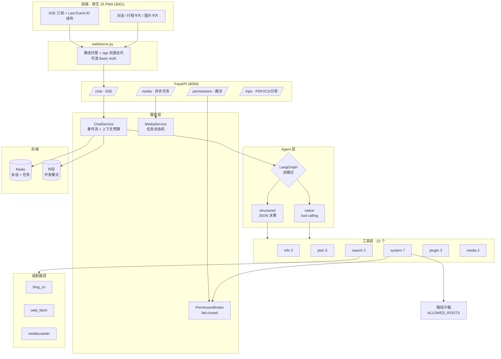

# Ocean · 旅行规划 Agent

> 一个可落地的旅行规划智能体后端：22 个工具、双模式 Agent 循环、可续传的 SSE 流、默认拒绝的权限网关。
> 目标不是演示 Demo，而是把 Agent 从「能跑」推到「敢让它碰文件和钱包」的那一步。

[](https://github.com/tongyuan34-ops/ocean-travel-agent/actions/workflows/ci.yml)
[](https://www.python.org/)
[](https://fastapi.tiangolo.com/)
[](https://langchain-ai.github.io/langgraph/)

---

## 它解决什么问题

通用对话模型做旅行规划有三个硬伤：**事实会编、行程不可执行、结果没法协作**。这个项目针对性地做了三件事：

| 硬伤 | 做法 |
|---|---|
| 编造天气、距离、开放时间 | 22 个工具全部走真实数据源（高德 / 和风 / 必应），System Prompt 强制「先调工具、查不到就说查不到」，工具返回带 `SEARCH_FAILED` 时不允许用常识补足 |
| 行程不可执行 | `plan_trip` 逐段调用高德路线接口算真实里程与耗时，不是估算；支持顺序优化（能省 20% 以上才提示）、单日在途超 5 小时告警、导出 PDF / ICS 日历 |
| 结果没法协作 | 只读分享页（`/share/{token}`，无会话标识、`noindex`）、会话持久化、断线续传、用户可随时中止 |

副作用是：它真的会读写你本机文件、真的会调生图接口花钱。所以权限、沙箱、可观测性这三块做得比业务逻辑还重。

---

## 架构



请求链路的关键一点：**SSE 生成任务不挂在 HTTP 请求上**。客户端断开只是停止订阅，回答继续跑完并落库，之后用 `GET /streams/{id}` + `Last-Event-ID` 续传。

---

## 四个核心设计

### 1. 双模式 Agent 循环，兼容无 function-call 能力的模型

`app/agent/graph.py`

不是所有模型都支持原生 tool calling（本地小模型、部分国产 API 都不支持）。项目把两种模式统一在同一个接口下：

```
native     : START → agent ⇄ tools → END        （LangGraph 原生 ToolNode）
structured : START → agent(内部 JSON 决策循环) → END
```

模型能力由 `detect_tool_calling()` 自动探测，也可用 `MODEL_TOOL_CALLING=native|structured` 强制指定。上层 `ChatService` 不需要区分两种模式，只在「能否逐字流式」上做降级。

### 2. 断线续传的 SSE 事件流

`app/services/chat.py:133-203` · `app/api/routes/chat.py`

事件类型：`token` / `tool_call` / `tool_result` / `permission_request` / `end` / `error` / `ping`

- 生成跑在 `asyncio.create_task` 里，与 HTTP 连接解耦
- 事件带自增 `seq`，写进 `StreamState.events`；重连时从 `last_event_id` 之后重放
- 15 秒无事件发心跳 `ping`——公网反代会掐断长时间无数据的连接
- 用户点「停止」时取消任务，且**不把半截回答写进历史**

### 3. 默认拒绝的权限网关

`app/agent/permissions.py`

有副作用的工具（`write_file` / `delete_path` / `open_file` / `set_wallpaper`）必须经用户在前端确认：

```
工具 → require_permission()
     → ContextVar 取到本会话的 PermissionBroker
     → 生成 request_id，推 permission_request 事件
     → await Future，等 POST /permissions/{id}/decision
     → 120 秒无决策 → PermissionDenied
```

设计原则只有一条：**失败方向必须是拒绝，不是放行**。超时、连接断开、未知 request_id、拿不到 broker（脚本直调工具）——全部收敛为不执行。

### 4. 路径沙箱

`app/core/security.py`

```
1. 先 resolve() 再校验    → 防软链接与 ../../ 绕过
2. 用 commonpath 比层级   → 防 /data-backup 被 /data 放行
3. 白名单为空则全拒       → 宁可工具不可用，也不默认放开
```

删除只允许删空目录、不允许删白名单根目录；单次读取上限 200KB，防止大文件撑爆上下文。

---

## 快速开始

### 方式一：Docker（推荐）

```bash
git clone https://github.com/tongyuan34-ops/ocean-travel-agent.git && cd ocean-travel-agent
cp .env.example .env
# 至少填 MODEL_API_KEY；其余可留空，未配置的工具会返回 TOOL_NOT_ENABLED
docker compose up --build
```

- 后端 http://localhost:8000 · 接口文档 http://localhost:8000/docs
- 前端 http://localhost:3001

### 方式二：本地（uv，推荐）

```bash
git clone https://github.com/tongyuan34-ops/ocean-travel-agent.git && cd ocean-travel-agent
cp .env.example .env
# 至少填 MODEL_API_KEY；其余可留空，未配置的工具会返回 TOOL_NOT_ENABLED

uv sync                         # 按 uv.lock 精确还原依赖（含 dev 组）

# 1) 起 Redis（不装也能跑：把 STORAGE_BACKEND 改回 memory）
docker run -d -p 6379:6379 redis:7-alpine

# 2) 起后端
uv run uvicorn app.main:app --reload --port 8000

# 3) 起前端（另一个终端）
uv run python web/serve.py      # 默认 3001，自动反代 /api 到 8000
```

### 方式三：本地（pip）

```bash
python -m venv .venv && .venv\Scripts\activate     # Windows
# source .venv/bin/activate                        # macOS / Linux
pip install -e ".[dev]"
cp .env.example .env
uvicorn app.main:app --reload --port 8000
python web/serve.py
```

手机同局域网访问：`web/serve.py` 启动时会打印局域网地址，扫码即用（见根目录 `mobile-access-qr.png`）。

### 验证

```bash
curl http://localhost:8000/api/v1/health
curl http://localhost:8000/api/v1/system/capabilities
```

`capabilities` 只反映**当前真实可用**的能力，不会谎报——前端据此隐藏入口，避免用户点到必然失败的按钮。

---

## 配置

完整清单见 [`.env.example`](.env.example)，关键项：

| 变量 | 说明 | 不配的后果 |
|---|---|---|
| `MODEL_NAME` / `MODEL_API_KEY` / `MODEL_BASE_URL` | 主模型（OpenAI 兼容协议） | 无法对话 |
| `MODEL_TOOL_CALLING` | `auto` / `native` / `structured` | 自动探测 |
| `MAP_API_KEY` | 高德 Web 服务，路线 / POI / 天气共用 | `plan_route` 等返回 `TOOL_NOT_ENABLED` |
| `WEATHER_API_KEY` | 和风 / OpenWeatherMap | 天气工具不可用 |
| `BING_SEARCH_API_KEY` | 必应检索；留空回退抓 cn.bing.com HTML | 检索质量下降 |
| `STORAGE_BACKEND` | `redis` / `memory` | 默认 memory，重启丢会话 |
| `ALLOWED_ROOTS` | 文件工具白名单，逗号分隔 | **留空 = 禁止所有文件操作** |
| `IMAGE_BACKEND` | `custom` / `none` | 生图不可用 |
| `ENABLE_SESSION_FETCH` | 社媒登录态采集，默认关 | 相关工具不可用 |

模型侧建议用支持 tool calling 的模型（DeepSeek / Qwen / GLM 均可），走 structured 模式时建议 7B 以上。

媒体链路（火山方舟 / Infinite Canvas）的详细接法见 [`docs/SETUP.md`](docs/SETUP.md)。

---

## 可观测性

Agent 的 bug 很少是崩溃，多是「这轮为什么选错了工具」「为什么说查不到」。所以每一轮对话生成一个 `trace_id`，同时出现在三个地方：

```
SSE end 事件    {"type":"end", "trace_id":"a1b2c3d4e5f60718", ...}
日志每一行      [a1b2c3d4e5f60718] app.services.chat: 调用工具 | tool=plan_route
LangSmith trace run_name = chat-a1b2c3d4e5f60718
```

用户报一个 id，就能从日志定位到完整链路；配上 LangSmith Key 后，同一条链路的每一次模型调用、工具入参出参、token 消耗都有可视化面板。

```bash
# .env
LANGSMITH_TRACING=true
LANGSMITH_API_KEY=lsv2_...
LANGSMITH_PROJECT=ocean-travel-agent
```

不配也能用——`trace_id` 照常生成并打进日志与 SSE，只是不上报。langsmith 是 `langchain-core` 的传递依赖，无需额外安装。

日志格式：

```
16:41:02 INFO    [a1b2c3d4e5f60718] app.services.chat: 调用工具 | tool=plan_route category=info
16:41:04 INFO    [a1b2c3d4e5f60718] app.services.chat: 本轮完成 | mode=native 回答=412 字 finish=stop 工具调用=3 生图任务=0
16:41:04 INFO    [a1b2c3d4e5f60718] app.services.chat: 本轮结束 | session=... 耗时=2.71s cancelled=False
```

---

## API 一览

| 方法 | 路径 | 说明 |
|---|---|---|
| `GET` | `/api/v1/health` | 健康检查 |
| `GET` | `/api/v1/system/capabilities` | 当前真实可用能力 |
| `POST` | `/api/v1/chat/sessions` | 建会话 |
| `POST` | `/api/v1/chat/sessions/{id}/messages` | 发消息，返回 SSE 流 |
| `GET` | `/api/v1/chat/streams/{id}` | 断线续传（`Last-Event-ID`） |
| `POST` | `/api/v1/chat/streams/{id}/cancel` | 中止生成 |
| `POST` | `/api/v1/permissions/{id}/decision` | 权限裁决 |
| `POST` | `/api/v1/media/images` | 提交生图任务（202 + task_id） |
| `GET` | `/api/v1/media/tasks/{id}` | 轮询任务状态 |
| `POST` | `/api/v1/trips/export` | 导出 PDF |
| `POST` | `/api/v1/trips/export/ics` | 导出 ICS 日历 |
| `GET` | `/share/{token}` | 只读分享页（无需登录） |

完整契约见 [`docs/SPEC.md`](docs/SPEC.md)（955 行，含每个事件的字段定义与错误码表）。

---

## 测试

```bash
uv run pytest                        # 118 passed
uv run pytest --cov=app              # 覆盖率
uv run ruff check . && uv run ruff format --check .
uv run mypy app
```

测试全部离线：用假图替换真实 Agent 图，不联网、不调模型。校验的是**事件协议、状态映射、安全边界**，不是模型能力。

覆盖重点：

- `test_chat_sse.py` — 事件顺序、续传重放、中止不落库、摘要失败不丢历史
- `test_permissions.py` — 超时拒绝、无 broker 拒绝、remember 语义
- `test_security.py` — 路径穿越、软链接、白名单为空、跨盘符
- `test_adapters.py` — 单源失败降级、超时、mock 标记
- `test_tracing.py` — trace_id 生成、上下文嵌套、SSE 与图 config 的 id 一致性
- `test_subprocess.py` — 子进程超时与编码

---

## 目录结构

```
app/
├── agent/           # Agent 循环、状态、22 个工具、权限
│   ├── graph.py     # 双模式图构建
│   ├── permissions.py
│   └── tools/       # info / plan / system / search / plugin / media
├── adapters/        # 检索源适配器（bing_cn / web_fetch / mediacrawler）
├── api/routes/      # chat / media / memory / permissions / share / system / tools / trips
├── core/            # 配置、上下文预算、错误、身份、网络、沙箱、日志、追踪
├── media/           # 生图/生视频后端与任务状态机
├── services/        # 会话、偏好、事件流、行程导出
├── storage/         # 会话存储（memory / redis）
└── main.py
web/                 # 原生 JS PWA + 本地反代服务器
tests/               # 118 个离线测试
docs/                # SPEC（接口契约）、SETUP（部署手册）、POSTMORTEM（工程复盘）
scripts/             # 批量对话、Cookie 注入、手工验证脚本
.github/workflows/   # CI：lint + 类型检查 + 双版本测试 + 镜像冒烟
```

工程化配置：

| 文件 | 作用 |
|---|---|
| `pyproject.toml` | 依赖声明 + ruff / mypy / pytest / coverage 配置（单一配置源） |
| `uv.lock` | 70 个包的精确版本与哈希，`uv sync --frozen` 可完全复现 |
| `requirements.txt` | 由 `uv export` 生成，给不用 uv 的场景兜底 |
| `Dockerfile` | 多阶段构建、非 root 用户、内置 healthcheck |
| `docker-compose.yml` | api + web + redis 一键起 |
| `.github/workflows/ci.yml` | ruff → mypy → pytest(3.12/3.13) → 镜像构建与冒烟 |

---

## 已知限制

写在这里而不是藏着，因为它们都是有意的取舍：

1. **单进程**。`ChatService._streams` 与权限请求注册表都在进程内，`uvicorn --workers > 1` 会让续传和权限回调打到别的进程。要横向扩展需换成 Redis Pub/Sub 或 Stream。
2. **媒体任务在内存**。进程重启后生图任务丢失，前端图片卡片无法重建。
3. **无账号体系**。身份是前端 `localStorage` 生成的设备 UUID（`X-Device-ID`），可伪造。前端反代层有 Basic Auth（`WEB_AUTH_USER` / `WEB_AUTH_PASS`），但那只是「挡住路人」，不是多租户隔离。对外部署必须换成真实鉴权。
4. **无限流**。模型额度可被无限刷。生产环境需在网关层加。
5. **structured 模式不流式**。该模式下模型输出的是内部 JSON 决策，不能直接透给用户，只能整段返回。
6. **token 估算用启发式**。`estimate_tokens()` 按中英混排比例估算，不是真 tokenizer，`MAX_CONTEXT_TOKENS` 预算会漂 ±15%。
7. **社媒采集有风控风险**。`ENABLE_SESSION_FETCH` 默认关闭，开启后需自行承担平台条款与封号风险。

---

## 许可

代码仅供学习与个人使用。第三方数据源（高德、和风、必应、火山方舟）的使用须遵守各自服务条款。若接入 [Infinite Canvas](https://github.com/tigerowo/infinite-canvas)（AGPL-3.0），请以独立服务方式 HTTP 调用，不要并入本仓库。
