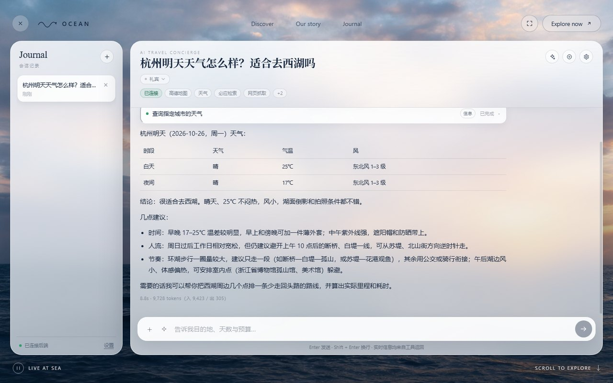
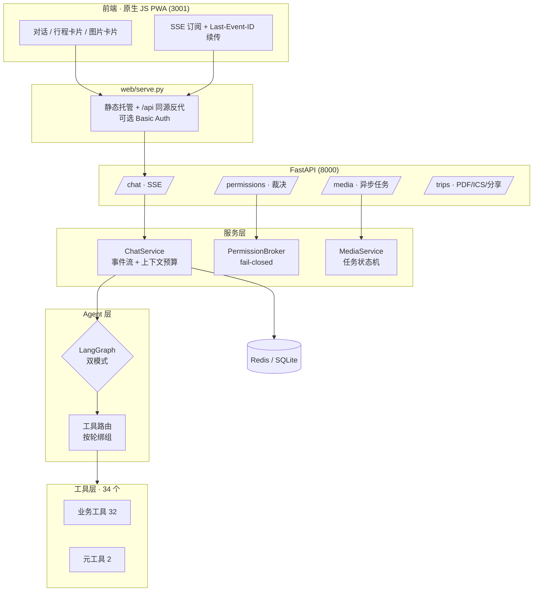

# Ocean · 旅行规划 Agent

> 一个可落地的旅行规划智能体：34 个工具 + 按轮工具路由、插件式技能、MCP 双向接入、双模式 Agent 循环、可续传 SSE、默认拒绝的权限网关。
> 目标不是演示 Demo，而是把 Agent 从「能跑」推到「敢让它碰文件和钱包」的那一步。

[](https://github.com/tongyuan34-ops/ocean-travel-agent/actions/workflows/ci.yml)
[](https://www.python.org/)
[](https://fastapi.tiangolo.com/)
[](https://langchain-ai.github.io/langgraph/)



## 直接下载（Windows）

**[OceanTravelAgent-0.2.2-setup.exe](https://github.com/tongyuan34-ops/ocean-travel-agent/releases/download/v0.2.2/OceanTravelAgent-0.2.2-setup.exe)**（42.6 MB）
· [免安装 zip](https://github.com/tongyuan34-ops/ocean-travel-agent/releases/download/v0.2.2/OceanTravelAgent-0.2.2-win64.zip)（50.1 MB）
—— 双击安装，不需要 Python / Docker / API Key，内置一份低额度 key，装完直接能用。
安装包未买代码签名证书，Windows 会提示「未知发布者」，点「更多信息 → 仍要运行」即可。

## 亮点

- **上下文成本治理**：工具与技能不再每轮全量下发。一句「你好」的固定输入从
  16,233 token 降到 1,875（−88%），工具召回率反而从 73.3% 升到 88.3%。
- **按轮工具路由**：32 个业务工具分 8 组，按触发词只绑当前需要的几组；追问沿用上一轮，
  漏网时模型可用 `discover_tools` 自救。
- **插件式技能**：每轮只注入 230 token 的技能清单，步骤正文与技能工具按需加载，
  单轮技能工具上限 4 个。
- **MCP 双向接入**：对外暴露 17 个只读工具，对内接入外部 MCP 服务端；
  自实现协议层（约 200 行），不引入官方 SDK 的整棵依赖树。
- **双模式 Agent 循环**：支持原生 tool calling，也支持无 function-call 能力的模型
  （结构化 JSON 决策）。
- **可续传 SSE**：断开只是停止订阅，回答继续跑完并落库，`Last-Event-ID` 续传。
- **默认拒绝的权限网关**：文件读写、删除、换壁纸都要当次确认；无裁决通道时一律拒绝。
- **可观测**：每轮 `trace_id` 贯穿 SSE / 日志 / LangSmith；`/metrics` 提供
  Prometheus 文本与 JSON 快照。

## 快速开始

### Docker（推荐）

```bash
git clone https://github.com/tongyuan34-ops/ocean-travel-agent.git && cd ocean-travel-agent
cp .env.example .env          # 至少填 MODEL_API_KEY
docker compose up --build
```

打开 <http://localhost:3001>。后端 8000 只在容器网络内，不发布到宿主机；
`web/serve.py` 需要 `WEB_AUTH_PASS`（compose 里是必填变量）。

不填 Key 也能进界面，发消息会收到明确错误码而不是白屏：

```
MODEL_UNAVAILABLE：MODEL_NAME / MODEL_BASE_URL 未配置，请在 .env 中填写
```

### 本地（uv）

```bash
uv sync
cp .env.example .env
# Redis 可选：不装就把 STORAGE_BACKEND 改成 sqlite 或 memory
uv run uvicorn app.main:app --reload --port 8000
uv run python web/serve.py     # 另一个终端，默认 3001
```

### 桌面版（Windows）

```bash
python scripts/build_desktop.py --installer
```

产物：`dist/OceanTravelAgent/`（解压即用）、`dist/OceanTravelAgent-*-win64.zip`、
`dist/OceanTravelAgent-*-setup.exe`。构建脚本会真的启动一次 exe 做冒烟：
健康检查、首页、知识库片段数、技能加载数全部核对，漏一项就失败。

### 验证

```bash
curl http://localhost:8000/api/v1/health
curl http://localhost:8000/api/v1/system/capabilities
```

`capabilities` 只报告**当前真实可用**的能力，前端据此隐藏入口，不放出必然失败的按钮。

## 上下文成本治理

Agent 的成本里有一块最容易被忽略：**工具定义是每轮请求都要重发的固定开销**。
历史会滚动、能被摘要折叠，`bind_tools` 的 schema 不会。重构前的实测（`tiktoken`，cl100k）：

| 项 | 重构前 | 重构后 |
|---|---|---|
| 系统提示词 | 3,089 | 1,554 |
| 工具 schema | 13,144（32 个全量） | 321（仅常驻元工具） |
| 一句「你好」的固定输入 | **16,233** | **1,875** |

做法不是砍工具，而是三层治理：

1. **按轮绑定**：8 个能力组（行程 / 住宿交通 / 交付 / 文档表格 / 本机文件 / 网页 / 社媒 / 生图），
   按触发词与正则只绑命中的组；`MAX_TOOLS=16` 防止退化成全量。
   三层兜底：宁可多绑一组、无信号时沿用上一轮、`discover_tools` 激活新组。
2. **技能按需加载**：技能清单每轮约 230 token，步骤正文只在用户显式选择或模型调用
   `use_skill` 时进入上下文；技能工具单轮最多 4 个，模板内联封顶 1,500 字符。
3. **MCP 划边界**：只暴露只读工具，外部工具同样走路由、预算与权限；
   协议层自己实现，少一整棵依赖树。

质量没有用 token 换：工具召回率 73.3% → 88.3%，评测通过率 72.5% → 82.9%
（41 条真实模型用例）。真实单轮对话 8.5k–13.3k token，约 ¥0.022–0.034。

踩过的坑写在 [docs/blog/context-cost-governance.md](docs/blog/context-cost-governance.md)：
删掉「事实必须先调工具」导致 6 个工具零调用、用 LLM 做意图分类被否、
每轮自动检索被否、图没有按工具集合缓存等等。

## 架构



SSE 生成任务不挂在 HTTP 请求上：客户端断开只是停止订阅，回答继续跑完并落库，
之后用 `GET /api/v1/chat/streams/{id}` + `Last-Event-ID` 续传。

## 核心设计

| 主题 | 做法 | 细节 |
|---|---|---|
| 双模式循环 | 原生 tool calling 优先，不支持时退回结构化 JSON 决策 | [SPEC 4.4](docs/SPEC.md) |
| 权限网关 | 默认拒绝；写文件与目录授权合并为一次确认；系统目录直接拒绝 | [guard.py](app/agent/guard.py) |
| 路径沙箱 | `ALLOWED_ROOTS` 白名单，防穿越、软链接、跨盘符；留空即全禁 | [security.py](app/core/security.py) |
| 间接注入防护 | 外部内容打标记、检测指令、污点按轮传播；被污染后写操作二次确认 | [guard.py](app/agent/guard.py) |
| 断线续传 | 事件日志 + TTL + 跨进程共享；停止靠共享标记轮询 | [turn_runtime.py](app/services/turn_runtime.py) |
| 上下文预算 | token 估算 + 滚动摘要；摘要失败不推进指针，历史不丢 | [context.py](app/core/context.py) |
| 文档能力 | 只读结构不读字节；编辑只写副本；排序筛选是查询不是编辑 | [SPEC 4.9](docs/SPEC.md) |
| 生图任务 | 202 + task_id 状态机，前端轮询；后端不可用时明确报错 | [media/](app/media/) |

## API 一览

| 方法 | 路径 | 说明 |
|---|---|---|
| `GET` | `/api/v1/health` | 健康检查（版本、模型、知识片段数、技能数） |
| `GET` | `/api/v1/metrics` | 指标快照（JSON） |
| `GET` | `/metrics` | 指标（Prometheus 文本 0.0.4） |
| `GET` | `/api/v1/system/capabilities` | 当前真实可用能力 |
| `POST` | `/api/v1/chat/sessions` | 建会话 |
| `POST` | `/api/v1/chat/sessions/{id}/messages` | 发消息，返回 SSE 流 |
| `GET` | `/api/v1/chat/sessions/{id}/messages` | 拉历史 |
| `PATCH` | `/api/v1/chat/sessions/{id}/persona` | 切换对话风格 |
| `PATCH` | `/api/v1/chat/sessions/{id}/skill` | 固定 / 清空会话技能 |
| `GET` | `/api/v1/chat/streams/{id}` | 断线续传（`Last-Event-ID`） |
| `POST` | `/api/v1/chat/streams/{id}/cancel` | 中止生成 |
| `GET` | `/api/v1/chat/sessions/{id}/usage` | 会话累计 token 与成本 |
| `GET` | `/api/v1/skills` | 技能清单（不含步骤正文） |
| `POST` | `/api/v1/permissions/{id}/decision` | 权限裁决 |
| `POST` | `/api/v1/media/uploads` | 上传图片（同步） |
| `POST` | `/api/v1/media/images` | 提交生图任务（202 + task_id） |
| `GET` | `/api/v1/media/tasks/{id}` | 轮询任务状态 |
| `POST` | `/api/v1/trips/export` | 导出 PDF |
| `POST` | `/api/v1/trips/export/ics` | 导出 ICS 日历 |
| `GET` | `/share/{token}` | 只读分享页（无需登录） |

完整契约见 [docs/SPEC.md](docs/SPEC.md)（事件字段与错误码表）。

## 配置

完整清单见 [.env.example](.env.example)，关键项：

| 变量 | 说明 | 不配的后果 |
|---|---|---|
| `MODEL_NAME` / `MODEL_API_KEY` / `MODEL_BASE_URL` | 主模型（OpenAI 兼容） | 无法对话 |
| `MODEL_TOOL_CALLING` | `auto` / `native` / `structured` | 自动探测 |
| `MAP_API_KEY` | 高德（路线 / POI / 天气） | 相关工具返回 `TOOL_NOT_ENABLED` |
| `BING_SEARCH_API_KEY` | 必应检索；留空回退 HTML 抓取 | 检索质量下降 |
| `STORAGE_BACKEND` | `sqlite` / `redis` / `file` / `memory` | 默认 memory，重启丢会话 |
| `ALLOWED_ROOTS` | 文件工具白名单 | **留空 = 禁止所有文件操作** |
| `TOOL_ROUTING` | `auto` / `all` | `all` 仅用于排查（退回全量绑定） |
| `MAX_TOKENS_PER_SESSION` | 会话级 token 预算闸 | 0 = 不限 |

## 可观测性

每轮对话生成一个 `trace_id`，同时出现在 SSE `end` 事件、每一行日志、LangSmith trace 名：

```
SSE end   {"type":"end","trace_id":"a1b2c3d4e5f60718", ...}
日志      [a1b2c3d4e5f60718] app.services.chat: 调用工具 | tool=plan_route
LangSmith run_name = chat-a1b2c3d4e5f60718
```

指标端点：`GET /api/v1/metrics`（JSON）与 `GET /metrics`（Prometheus 文本），
采集 HTTP 请求、对话轮次、工具调用、技能激活。抓取端需要带 Basic Auth
（`/api/v1/health` 是唯一公开路径）；桌面版无密码、只听回环，直接抓即可。
注意 `web/serve.py` 只代理 `/api/`，**3001 端口拿不到 `/metrics`**。

```yaml
scrape_configs:
  - job_name: ocean-travel-agent
    metrics_path: /metrics
    basic_auth: { username: ocean, password: ${WEB_AUTH_PASS} }
    static_configs: [{ targets: ["127.0.0.1:8765"] }]
```

## 评测与测试

`tests/` 验「代码没写错」，`evals/` 验「模型没做错」——两者的失败含义不同。

```bash
uv run pytest                                   # 946 条，全离线、不调模型
uv run ruff check . && uv run ruff format --check .
uv run mypy app evals

uv run python -m evals.run --self-test          # CI 里跑，不花钱
uv run python -m evals.run --baseline evals/baseline.json --fail-on-regression
```

评测 41 条用例，覆盖工具选择、多工具串联（含顺序）、不该调工具、工具路由、
权限拒绝、工具失败不编造、间接提示注入、人格切换。指标包括通过率、工具召回率、
误调数、禁用工具真的执行数、P50/P95、token 与成本。

基线（同一套 40 条，三轮）：通过率 70.0% → 77.5% → 72.5%，这个回落是噪声；
41 条时代定稿为 34/41（82.9%）、召回 88.3%。详见 [evals/BASELINE.md](evals/BASELINE.md)。

## 目录结构

```
app/
├── agent/           # 双模式图、按轮工具路由、提示词、注入防护、权限
├── adapters/        # 检索源适配器（bing_cn / web_fetch / mediacrawler）
├── api/routes/      # chat / media / memory / metrics / permissions / share / system / tools / trips
├── core/            # 配置、上下文预算、错误、身份、网络、沙箱、日志、指标、追踪
├── media/           # 生图/生视频后端、任务状态机、上传图片
├── mcp/             # MCP 协议层：服务端（对外）+ 客户端（接入外部）
├── rag/             # 中文二元组分词、按标题切块、BM25 检索
├── services/        # chat 编排、sessions、turn_context、turn_runtime、事件与错误纯函数
├── storage/         # memory / redis / sqlite / file
├── skills/          # 技能加载与注册（清单 + 按需正文 + 进程内工具）
├── standalone.py    # 单端口入口：静态页 + API 同进程，带 Basic 鉴权
└── main.py
knowledge/           # 规则与判断标准（不存班次票价这类实时事实）
web/                 # 原生 JS PWA + 本地反代服务器
tests/               # 946 条离线测试
evals/               # 41 条评测用例 + 判分框架
docs/                # SPEC / SETUP / ADR / AUDIT / 技术文章
.github/workflows/   # CI：ruff → mypy → pytest → 评测自测 → 镜像冒烟
```

## 已知限制

1. **多进程「能跑」但不「无感」**：续传与权限回调支持跨进程，但流状态有 1 小时 TTL；
   跨进程停止最多晚 1 秒生效。
2. **媒体任务在内存**：进程重启后生图任务丢失。
3. **无账号体系**：身份是前端生成的设备 UUID，可伪造；Basic Auth 只挡路人。
4. **无 IP 级限流**：有会话级 token 预算闸，但同一 IP 可无限建会话。
5. **structured 模式不流式**：内部 JSON 决策不能直接透给用户，只能整段返回。
6. **预算用启发式估算**：`MAX_CONTEXT_TOKENS` 会漂 ±15%；账单走模型返回的 `usage_metadata`。
7. **社媒采集有风控风险**：`ENABLE_SESSION_FETCH` 默认关闭。

## 许可

[MIT](LICENSE)。第三方数据源（高德、和风、必应、火山方舟）须遵守各自服务条款。
接入 [Infinite Canvas](https://github.com/tigerowo/infinite-canvas)（AGPL-3.0）时请以独立服务 HTTP 调用。
